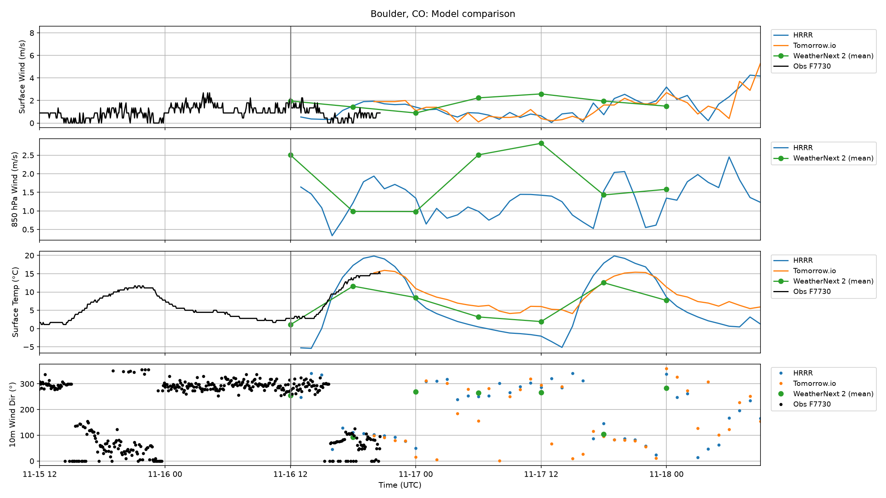

# Winds in Boulder

A Python tool that compares point forecasts of surface wind (plus 1000 m wind, 2 m temperature, and wind direction) for a single location near Boulder, CO, from five forecast models, and plots them against the latest station observations.

I built it to see how the new AI weather models compare with conventional and commercial downscaled models for local wind, which is what matters for flying (paragliding) in the Front Range.

## Forecast sources

| Model | Type | Resolution |
|---|---|---|
| [HRRR](https://rapidrefresh.noaa.gov/hrrr/) (NOAA) | Physics-based, convection-allowing, North America only | 3 km |
| [Meteomatics US](https://www.meteomatics.com/en/weather-model-us/) | Commercial downscaled model | 1 km |
| [tomorrow.io](https://www.tomorrow.io/blog/how-does-the-technology-behind-tomorrow-io-work/) | Commercial downscaled model | ~2 km (model description is not fully clear) |
| [GraphCast](https://deepmind.google/science/weathernext/#access-weathernext) (Google DeepMind, via WeatherNext / Earth Engine) | AI, deterministic, global | ~25 km |
| [GenCast](https://deepmind.google/science/weathernext/#access-weathernext) (Google DeepMind, via WeatherNext / Earth Engine) | AI, ensemble, global | ~25 km |

## Observations

- [Synoptic](https://viewer.synopticdata.com/map/data/now/air-temperature?layers=#map=11.44/39.9991/-105.2799) station network (stations in Boulder)
- METAR data from the [Iowa Environmental Mesonet](https://mesonet.agron.iastate.edu/request/asos/1min.phtml) (Boulder airport METAR is unfortunately not available there)

## Usage

1. Create the environment: `conda env create -f wind_comp_python_environment.yml`
2. Copy `access_keys_template.py` to `access_keys.py` and fill in your own keys (tomorrow.io, Meteomatics, and Synoptic all offer free trials; WeatherNext data needs a Google Earth Engine project).
3. Set the location (`LAT`, `LON`) at the top of `wind_data_comp.py` and run it.

## To do

- Retrieve the latest forecast instead of the forecast from 6 h ago (the Google models have some latency)
- Include past (historical) forecast hours where the models provide them
- Store forecasts and observations in a database to compare longer time series and compute verification statistics
- Compare against more ground-truth measurements (e.g., the RMHPA station)
- Extend the comparison (upper-level winds, spatial variability)
