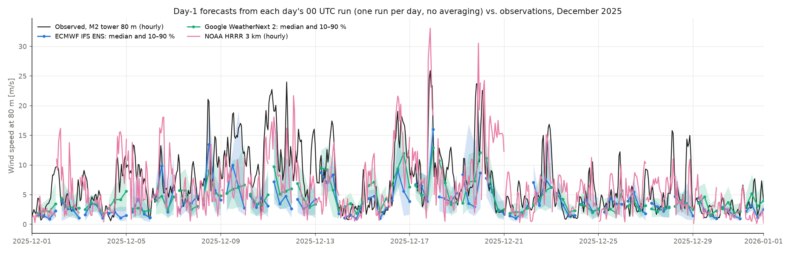

# Forecast verification: December 2025 at the NREL M2 tower

How well do AI and physics-based weather models, ensemble and deterministic, forecast hub-height wind near Boulder, CO?

**Site:** NREL (now National Laboratory of the Rockies) Flatirons Campus [M2 tower](https://midcdmz.nlr.gov/apps/go2url.pl?site=NWTC), 39.91 N, 105.23 W, 1855 m, about 8 km south of Boulder. Wind at 2–80 m, 1-minute data.

**Month:** December 2025, the windiest month of winter 2025/26 at the tower (66 hours above 15 m/s at 80 m, gusts up to 47 m/s). Downslope windstorms off the Front Range make this a hard test.

## Models

| | Deterministic | Ensemble |
|---|---|---|
| **Physics-based** | ECMWF IFS control member, NOAA GFS, NOAA HRRR (3 km) | ECMWF IFS ENS (51 members) |
| **AI** | ECMWF AIFS Single | ECMWF AIFS ENS (51), Google WeatherNext 2 (64) |

All global models are at 0.25° (~25 km). Point forecasts are the nearest grid point. Data sources: [dynamical.org](https://dynamical.org) cloud archives (Icechunk Zarr on AWS) for ECMWF, GFS and HRRR; Google Earth Engine for WeatherNext 2.

## Method

- 31 forecast runs (00 UTC, 1–31 Dec 2025), lead times 6 h to 7 days in 6-hour steps (HRRR to 48 h).
- Hub height = 80 m (top of the tower). HRRR and GFS provide 80 m wind directly. For the ECMWF models and WeatherNext 2, which provide 10 m and 100 m, the wind is interpolated to 80 m with a power law fitted between the two levels for each forecast. Observations: hourly means centred on the forecast valid time.
- Score: **CRPS** for ensembles (fair estimator, so 51 and 64 members compare fairly) and **MAE** for deterministic forecasts. For a single-value forecast CRPS equals the absolute error, so both share one axis.

## Results




Day-1 forecasts: each day's 00 UTC run, one run per valid time (no averaging across runs): global ensembles every 6 h (lead 6–24 h, median and 10–90 % range), HRRR hourly (lead 1–24 h). Gaps in the HRRR line are missing HRRR runs in the archive.

Hub height (80 m), m/s. HRRR only runs to 48 h, so the first column compares all models over the same lead times:

| Model | CRPS / MAE, leads ≤ 48 h | CRPS / MAE, all leads (≤ 7 d) | Bias, all leads |
|---|---|---|---|
| WeatherNext 2 (AI, ens.) | 2.38 | 2.57 | −2.2 |
| IFS ENS (physics, ens.) | 2.72 | 2.84 | −2.8 |
| AIFS ENS (AI, ens.) | 3.15 | 3.31 | −3.3 |
| GFS (physics, det.) | 3.69 | 4.16 | −2.3 |
| AIFS Single (AI, det.) | 3.71 | 4.05 | −3.6 |
| IFS control (physics, det.) | 3.74 | 4.14 | −3.2 |
| HRRR 3 km (physics, det.) | 3.99 (3.74 using every hour) | – | −0.3 |

The deterministic models are within about 0.3 m/s of each other, which is not significant for one month. Comparing HRRR and GFS on the same runs and hours (hourly, 80 m), with a 3-day block bootstrap over forecast runs:

| Lead time | MAE HRRR | MAE GFS | HRRR − GFS | 95 % CI |
|---|---|---|---|---|
| 1–48 h | 3.74 | 3.62 | +0.12 | −0.38 to +0.49 |
| 1–12 h | 3.20 | 3.21 | −0.01 | −0.79 to +0.64 |
| 13–48 h | 3.92 | 3.76 | +0.16 | −0.39 to +0.55 |

On MAE, HRRR and GFS are tied.

**Findings**

1. **Ensembles beat deterministic forecasts by a wide margin**, about 1 m/s at every lead time out to day 7. Spreading the forecast over plausible outcomes pays off at a site where the wind is so hard to pin down.
2. **AI vs. physics depends on the model, not the category.** WeatherNext 2 was the best model overall; ECMWF's own AI ensemble (AIFS ENS) was worse than its physics ensemble (IFS ENS). Among deterministic models, AIFS Single was slightly better than the IFS control.
3. **All global models are too slow by 2–3 m/s**, most at midday. At 25 km they cannot resolve the downslope windstorms, so the error is dominated by this systematic bias and barely grows with lead time.
4. **HRRR (3 km) gets the wind level right (bias near zero) but not the timing** (see the HRRR tests below). On day 1 it is on par with the other deterministic models (MAE about 3.6 m/s); on day 2 it is worse. It forecasts strong-wind episodes with realistic amplitude, but when they are a few hours off it is penalized twice (once for the miss, once for the false alarm), while smooth global forecasts hedge. For winds above 12 m/s (43 cases, leads ≤ 48 h) HRRR caught 10 events with 22 false alarms; WeatherNext 2 (≥ 20 % of members) caught 17 with 4 false alarms.

**HRRR sanity checks** (`diag_hrrr.py`, `diag_hrrr2.py`): no time-zone or time-stamp error (shifting the observations by ±10 h does not improve HRRR at ±7 h, and all models are best at 0 to −1 h); of a 7 × 7 neighbourhood around the tower, the nearest grid point (1.8 km away) has the lowest MAE, with a strong west–east gradient (grid points 5–10 km west, in the foothills, are 3–6 m/s too windy); with hourly instead of 6-hourly valid times HRRR's MAE is 3.7 m/s, and 3.1 m/s for the first 6 hours. All runs here are 00 UTC, so HRRR's main strength, hourly updates with short lead times, is not tested.

**Caveats:** one month and one site, 31 runs. Confidence intervals so far only for HRRR vs. GFS; the ranking of the other models still needs them (consecutive days are correlated, so small differences may be noise). The Earth Engine pixel for WeatherNext 2 is reported at 39.875 N, 105.125 W, half a grid cell from the ECMWF grid point (40.0 N, 105.25 W); this is probably a pixel-registration convention, but it is not yet verified.

## Does HRRR really lose in complex terrain? (`hrrr_tests.py`)

Point MAE at fixed times punishes a sharp, high-resolution forecast for small timing errors. Three fairer tests:

**A. Latest run, every hour.** Using the most recent HRRR cycle (lead 1–6 h) for every hour of December: MAE 3.2 m/s, bias −0.5, correlation 0.64, the best correlation of any model. GFS at the same lead times: MAE 3.2, but bias −2.1.

**B. Daily maximum 80 m wind** (the windstorm strength, regardless of the exact hour; 00 UTC run, same MST day):

| Model | CRPS / MAE | Bias |
|---|---|---|
| HRRR, hourly | **4.1** | **0.0** |
| GFS, hourly | 4.5 | −3.6 |
| HRRR sampled 6-hourly (like the global models) | 5.5 | −3.2 |
| WeatherNext 2 / IFS ENS, 6-hourly | 5.1 / 5.5 | −6.1 / −6.6 |
| AIFS Single / IFS control, 6-hourly | 8.3 / 7.4 | −8.3 / −7.4 |

**C. HRRR as a neighbourhood ensemble** (5 × 5 grid points ≈ ±6 km, × ±1 h = 75 members), CRPS at the same 6-hourly times and leads (6–48 h):

| Model | CRPS / MAE |
|---|---|
| WeatherNext 2 | 2.38 |
| **HRRR neighbourhood ensemble** | **2.59** |
| IFS ENS | 2.72 |
| AIFS ENS | 3.15 |
| GFS / AIFS Single / IFS control | 3.69 / 3.71 / 3.74 |
| HRRR, nearest point | 3.99 |

**Conclusion:** HRRR does know the terrain winds. It is the only model without a large low bias, it predicts the daily peak wind best, and treated probabilistically it beats every physics-based model and ECMWF's AI ensemble. What it loses on is the exact timing of each gust episode, which a point-to-point score at fixed hours punishes twice. The 6-hourly output of the global models also hides peaks, so they cannot be scored on daily maxima fairly (sampling the HRRR 6-hourly raises its error from 4.1 to 5.5 m/s).

## Next steps

- Block-bootstrap confidence intervals for the model differences
- Spread–skill: are the ensembles' uncertainties honest?
- More months, and snow as a case study

## Run it

```
python get_obs_m2.py 2025-11-01 2026-03-31          # tower data, hourly
python get_forecasts.py 2025-12-01 2025-12-31       # point forecasts, all models
python verify.py 2025-12-01 2025-12-31              # scores
python plot_scores.py 2025-12-01 2025-12-31         # figures
```

Extra packages: `dynamical-catalog`, `icechunk`, `zarr`, `pyarrow`, `earthengine-api` (WeatherNext 2 needs an Earth Engine project in `access_keys.py`). Processed point data are in `data/processed/` (a few MB), so the scores and figures can be rebuilt without downloading anything.
