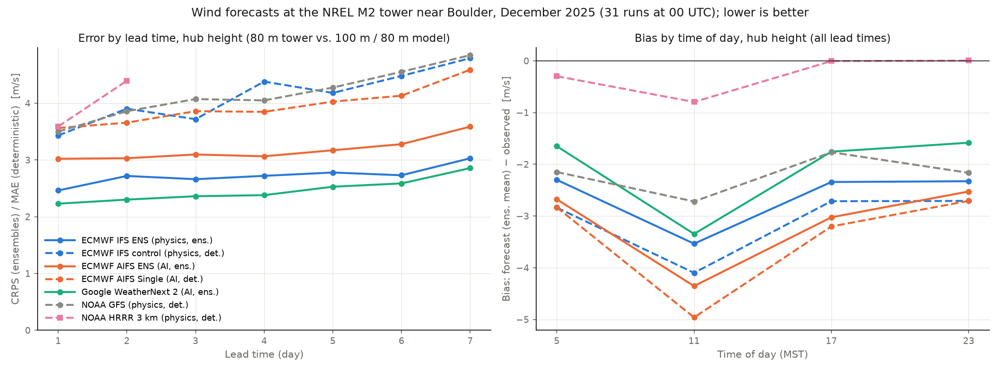

# Forecast verification: December 2025 at the NREL M2 tower

How well do AI and physics-based weather models, ensemble and deterministic, forecast hub-height wind near Boulder, CO?

**Site:** NREL (now National Laboratory of the Rockies) Flatirons Campus [M2 tower](https://midcdmz.nlr.gov/apps/go2url.pl?site=NWTC), 39.91 N, 105.23 W, 1855 m, about 8 km south of Boulder. Wind at 2–80 m, 1-minute data.

**Month:** December 2025, the windiest month of winter 2025/26 at the tower (66 hours above 15 m/s at 80 m, gusts up to 47 m/s). Downslope windstorms off the Front Range make this a hard test.

## Models

| | Deterministic | Ensemble |
|---|---|---|
| **Physics-based** | ECMWF IFS control member, NOAA GFS, NOAA HRRR (3 km) | ECMWF IFS ENS (51 members) |
| **AI** | ECMWF AIFS Single | ECMWF AIFS ENS (51), Google WeatherNext 2 (64) |

All global models are at 0.25° (~25 km). Point forecasts are the nearest grid point. Data sources: [dynamical.org](https://dynamical.org) cloud archives (Icechunk Zarr on AWS) for ECMWF, GFS and HRRR; Google Earth Engine for WeatherNext 2.

## Method

- 31 forecast runs (00 UTC, 1–31 Dec 2025), lead times 6 h to 7 days in 6-hour steps (HRRR to 48 h).
- Hub height: tower 80 m vs. model 100 m wind (HRRR 80 m). Observations: hourly means centred on the forecast valid time.
- Score: **CRPS** for ensembles (fair estimator, so 51 and 64 members compare fairly) and **MAE** for deterministic forecasts. For a single-value forecast CRPS equals the absolute error, so both share one axis.

## Results




Mean over all lead times, hub height (m/s):

| Model | CRPS / MAE | Bias |
|---|---|---|
| WeatherNext 2 (AI, ens.) | 2.46 | −2.1 |
| IFS ENS (physics, ens.) | 2.73 | −2.6 |
| AIFS ENS (AI, ens.) | 3.18 | −3.2 |
| AIFS Single (AI, det.) | 3.95 | −3.4 |
| HRRR, ≤ 48 h (physics, det.) | 3.99 | −0.3 |
| IFS control (physics, det.) | 4.13 | −3.1 |
| GFS (physics, det.) | 4.16 | −2.2 |

**Findings**

1. **Ensembles beat deterministic forecasts by a wide margin**, about 1 m/s at every lead time out to day 7. Spreading the forecast over plausible outcomes pays off at a site where the wind is so hard to pin down.
2. **AI vs. physics depends on the model, not the category.** WeatherNext 2 was the best model overall; ECMWF's own AI ensemble (AIFS ENS) was worse than its physics ensemble (IFS ENS). Among deterministic models, AIFS Single was slightly better than the IFS control.
3. **All global models are too slow by 2–3 m/s**, most at midday. At 25 km they cannot resolve the downslope windstorms, so the error is dominated by this systematic bias and barely grows with lead time.
4. **HRRR (3 km) gets the wind level right (bias near zero) but not the timing.** It forecasts strong-wind episodes, but when they are off by a few hours it is penalized twice, so its MAE is no better than the global models.

**Caveats:** one month and one site, 31 runs, no confidence intervals yet (consecutive days are correlated, so small differences may be noise). The Earth Engine pixel for WeatherNext 2 is reported at 39.875 N, 105.125 W, half a grid cell from the ECMWF grid point (40.0 N, 105.25 W); this is probably a pixel-registration convention, but it is not yet verified.

## Next steps

- Block-bootstrap confidence intervals for the model differences
- Spread–skill: are the ensembles' uncertainties honest?
- More months, and snow as a case study

## Run it

```
python get_obs_m2.py 2025-11-01 2026-03-31          # tower data, hourly
python get_forecasts.py 2025-12-01 2025-12-31       # point forecasts, all models
python verify.py 2025-12-01 2025-12-31              # scores
python plot_scores.py 2025-12-01 2025-12-31         # figures
```

Extra packages: `dynamical-catalog`, `icechunk`, `zarr`, `pyarrow`, `earthengine-api` (WeatherNext 2 needs an Earth Engine project in `access_keys.py`). Processed point data are in `data/processed/` (a few MB), so the scores and figures can be rebuilt without downloading anything.
